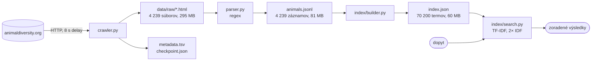

# 1. Odovzdanie – Vyhľadávač živočíšnych druhov (Animal Diversity Web)

> Termín 28.10.2026. DokuWiki: `user:jozef.ziduliak:1.odovzdanie`. Kód: https://github.com/JozefZiduliak/vinf (tag `v0.4.0`).

## 1. Opis projektu a cieľ

Cieľom je vyhľadávač živočíšnych druhov postavený od nuly: vlastný crawler, extrakcia regexom, vlastný invertovaný index a TF-IDF ranking. Dáta sú účty druhov z Animal Diversity Web (ADW), kde má každý druh stránku s rovnakou šablónou sekcií. Z každej stránky berieme 5 atribútov (taxonómia, geografický rozsah, habitat, potrava, stav ohrozenia IUCN) a plný text. Používateľ zadá voľný text, napríklad „nocturnal desert rodent", a dostane zoradený zoznam druhov s atribútmi.

Motivácia: cieľom je prejsť celým IR pipeline vlastnými rukami, od crawlera po ranking, a vidieť, kde čisté TF-IDF stačí a kde nie. Živočíchy sú na to vhodná doména: každá stránka má rovnakú šablónu, takže sa dá spracovať regexom, kombinuje voľný text so štruktúrovanými štítkami (habitat, potrava, IUCN), a vedecké meno je jednoznačný kľúč na spojenie s Wikipédiou. Vyhľadávanie ADW nám v závere poslúži ako referencia na porovnanie. V druhej časti semestra záznamy spojíme cez vedecké meno s článkami z anglickej Wikipédie (Spark nad dumpom) a index prebudujeme v PyLucene.

Pipeline má štyri kroky, každý číta výstup predchádzajúceho:



Spúšťanie: `uv run dev crawl | parse | build-index | search "dopyt" | show <slug> | stats`.

## 2. Scrapované stránky a extrahované dáta

Doména: https://animaldiversity.org (University of Michigan). Dokument = účet druhu `/accounts/<Genus_species>/`, napríklad https://animaldiversity.org/accounts/Panthera_leo/ . Stránky sú čisté HTML bez JavaScriptu, robots.txt povoľuje `/accounts/` a žiada `Crawl-delay: 8`.

Z každého účtu extrahujeme vedecké meno, bežný názov, taxonómiu (Kingdom až Genus), štítky Biogeographic Regions (rozsah), Habitat Regions + Terrestrial Biomes (habitat), Primary Diet (potrava), kategóriu IUCN Red List a text všetkých sekcií (Geographic Range, Habitat, Physical Description, Reproduction, Behavior, Food Habits, Conservation Status, ...).

Päť ukážok z `data/animals.jsonl`:

| Vedecké meno | Bežný názov | Trieda / rad / čeľaď | Rozsah | Habitat (prvé 4) | Potrava | IUCN | Slov v texte |
|---|---|---|---|---|---|---|---|
| Panthera leo | lion | Mammalia / Carnivora / Felidae | palearctic, oriental, ethiopian | temperate, tropical, terrestrial, savanna or grassland | carnivore | Vulnerable | 3 417 |
| Melopsittacus undulatus | budgerigar | Aves / Psittaciformes / Psittacidae | nearctic, australian | savanna or grassland, forest | herbivore | Least Concern | 997 |
| Ornithorhynchus anatinus | duck-billed platypus | Mammalia / Monotremata / Ornithorhynchidae | australian | temperate, tropical, terrestrial, freshwater | carnivore | No special status | 1 281 |
| Carcharodon carcharias | Great white shark | Chondrichthyes / Lamniformes / Lamnidae | atlantic ocean, pacific ocean | temperate, tropical, saltwater or marine | carnivore | Vulnerable | 2 118 |
| Apis mellifera | honey bee | Insecta / Hymenoptera / Apidae | nearctic, palearctic, oriental, ethiopian, neotropical, australian | temperate, tropical, terrestrial, desert or dune | herbivore | No special status | 4 424 |

Jeden záznam v JSONL (skrátený):

```json
{"slug": "Ornithorhynchus_anatinus", "scientific_name": "Ornithorhynchus anatinus",
 "common_name": "duck-billed platypus",
 "taxonomy": {"Kingdom": "Animalia", "Phylum": "Chordata", "Class": "Mammalia", "Order": "Monotremata", "Family": "Ornithorhynchidae", "Genus": "Ornithorhynchus"},
 "conservation_status": "No special status",
 "range": ["australian"], "habitat": ["temperate", "tropical", "terrestrial", "freshwater"], "diet": ["carnivore"],
 "sections": {"geographic_range": "The geographic range of Ornithorhynchus anatinus is restricted to the wetter regions of eastern Australia and Tasmania. ...", "habitat": "...", ...},
 "text": "The geographic range of ..."}
```

Pokrytie atribútov na celom korpuse (4 239 dokumentov):

| Atribút | Dokumentov | Podiel |
|---|---|---|
| taxonómia | 4 239 | 100 % |
| plný text | 4 239 | 100 % |
| geografický rozsah | 4 192 | 98,9 % |
| IUCN status | 4 137 | 97,6 % |
| habitat | 4 001 | 94,4 % |
| bežný názov | 3 597 | 84,9 % |
| potrava | 3 523 | 83,1 % |

Chýbajúce hodnoty sú chýbajúce na stránke, nie chyba regexu (overené na vzorke ručne). Rozdelenie IUCN: Least Concern 2 104, No special status 455, Not Evaluated 384, Vulnerable 316, Endangered 244, Near Threatened 239, Critically Endangered 149, Data Deficient 133, staré kategórie Lower Risk 90, Extinct 23.

## 3. Príklady dopytov a odpovedí

Dopyt je voľný text, odpoveď je zoradený zoznam druhov so skóre, bežným názvom, taxonómiou, IUCN statusom a termami dopytu, ktoré dokument obsahuje. Stĺpec „Reálne" je výstup aktuálnej verzie (classic IDF, bez stemmingu).

| # | Dopyt | Očakávaná odpoveď | Reálne (top 1) | Čo testuje |
|---|---|---|---|---|
| 1 | Panthera leo | Panthera leo, potom ostatné druhy rodu Panthera | Panthera pardus (leopard), lev až druhý | presná zhoda mena; leopard má kratší text a leva v ňom spomína často, mená budú mať vlastné pole v Lucene |
| 2 | australia parrot popular pet | Melopsittacus undulatus (budgerigar) | Amazona autumnalis, andulka 6. | voľný text + rozsah; na stránke je „Australian", nie „australia" |
| 3 | lions in africa | Panthera leo | Panthera leo, potom uškatce (sea lion) | bag-of-words nevie, že „sea lions" nie sú levy |
| 4 | hibernates during winter | Ursus americanus, Marmota, Tamias | Dolichovespula arenaria (osa), Rana cascadae | voľný text z Behavior, bez atribútov |
| 5 | nocturnal desert rodent | Dipodomys, Chaetodipus | Dipsosaurus dorsalis (leguán), 3. Sciurus yucatanensis | tri atribúty; „desert" má najväčšiu váhu, lebo je najzriedkavejší |
| 6 | mammal that lays eggs | Ornithorhynchus anatinus, Tachyglossus aculeatus | Fasciola hepatica (motolica), vtákopysk mimo top 100 | vtákopysk má v texte „lay eggs" a „egg-laying", nie „lays eggs" |

Dopyty 1, 2 a 6 ukazujú limity čistého TF-IDF nad jedným textovým poľom: žiadne frázy, žiadne synonymá, žiadna váha pre meno. Presne toto riešia fieldy a frázové dopyty v PyLucene v tretej časti.

## 4. Frameworky a knižnice

Python 3.14 cez `uv`, deklarované `requires-python >= 3.11`. V prvej časti zámerne bez vyhľadávacích knižníc, index a ranking sú vlastné.

| Knižnica | Použitie |
|---|---|
| `requests` | HTTP GET s hlavičkami a timeoutom, `allow_redirects=False` (302 = druh bez účtu) |
| `re` (stdlib) | extrakcia odkazov v crawleri, extrakcia atribútov a textu v parseri, tokenizácia |
| `urllib.robotparser` (stdlib) | `can_fetch()`, `crawl_delay()` z robots.txt |
| `collections.deque`, `Counter`, `defaultdict` (stdlib) | fronta BFS, term frequency, postings |
| `json`, `csv`, `pathlib`, `logging` (stdlib) | checkpoint, metadáta TSV, index na disku, logy so štatistikami |
| `pydantic` | model `Animal`, validácia a serializácia do JSONL, spätné načítanie v indexeri |
| `html.unescape`, `math` (stdlib) | entity `&amp;` v texte, `log` v IDF |
| `tiktoken` | len štatistika počtu LLM tokenov (bonus) |
| `pytest`, `ruff` (dev) | unit testy regexov, lint |

## 5. Architektúra crawlera

{{user:jozef.ziduliak:crawler_hld.png?700}}

Crawler je BFS prechod taxonomického stromu ADW od koreňa `/accounts/Animalia/classification/`. Klasifikačné stránky sa spracúvajú do šírky, účty druhov (listy) majú prednosť a sťahujú sa hneď po objavení. Stav drží fronta `deque` a množina `seen` (URL pridané do fronty, bráni duplicitám a cyklom cez odkazy na predkov). Jedna iterácia:

1. vyber URL z fronty, over `robots.txt` cez `can_fetch()`,
2. stiahni (GET, hlavičky, timeout 15 s, 3 pokusy, bez presmerovaní), spi 8 s,
3. klasifikačná stránka: regexom vyber odkazy (cesta, rank, príznak `feature-less`); prázdne podstromy orež bez requestu; druhy preveď na URL účtu a daj na začiatok fronty; ostatné taxóny na koniec,
4. účet druhu so statusom 200: ulož HTML do `data/raw/<Genus_species>.html`,
5. každú URL zapíš do `metadata.tsv`, ulož checkpoint (fronta + seen) atomicky cez dočasný súbor a `os.replace`.

Pri štarte sa checkpoint načíta a crawler pokračuje, kde skončil. Bežal na Raspberry Pi 4 v `tmux` tri dni s viacerými prerušeniami.

Kľúčové zistenie: strom má ~200 000 uzlov, ale účet má len 4 239 druhov. Druh bez účtu vráti 302, uzly bez obsahu majú triedu `<div class="feature-less">` na každej úrovni. Orezávanie `feature-less` podstromov preskočilo 194 800 uzlov bez requestu a skrátilo crawl z odhadovaných týždňov na ~30 h.

## 6. Metadáta ukladané pri crawlovaní

Každá spracovaná URL má riadok v `data/metadata.tsv` (211 358 riadkov, z toho 194 800 orezaných uzlov bez requestu):

| url | type | status | timestamp | size | file |
|---|---|---|---|---|---|
| /accounts/Panthera/classification/ | classification | 200 | 2026-09-27T21:21:53 | 15569 | |
| /accounts/Panthera_leo/ | species | 200 | 2026-09-27T21:22:27 | 114255 | data/raw/Panthera_leo.html |
| /accounts/Lycorma_delicatula/ | species | 200 | 2026-10-03T13:02:16 | 64162 | data/raw/Lycorma_delicatula.html |
| /accounts/Lycorma_meliae/classification/ | pruned_species | | 2026-10-03T13:02:07 | 0 | |
| /accounts/Clathrina_heronensis/ | species | 302 | 2026-09-26T12:26:27 | 0 | |

`type` rozlišuje navigáciu, uložený účet a orezaný uzol (s rankom), `status` je HTTP kód (302 = druh bez účtu), `size` je veľkosť odpovede v bajtoch. Z tejto tabuľky sú všetky čísla v sekcii 13 a vieme z nej, ktoré URL treba pri retry skúsiť znova (status 0 = sieťová chyba).

## 7. Hlavičky, timeout, sleep

```python
CONTACT_EMAIL = "xziduliak@stuba.sk"
USER_AGENT = f"vinf-crawler/0.1 (FIIT STU student project; {CONTACT_EMAIL})"
HEADERS = {"User-Agent": USER_AGENT, "From": CONTACT_EMAIL, "Accept": "text/html"}
TIMEOUT = 15
DELAY_SECONDS = 8      # fallback, reálne sa číta z robots.txt
MAX_RETRIES = 3
```

- **User-Agent** a **From** identifikujú bota, projekt a kontakt, aby správca stránky mohol napísať namiesto blokovania. **Accept: text/html** hovorí, že nechceme obrázky ani JSON.
- **Sleep 8 s** je `Crawl-delay: 8` z robots.txt, načítané cez `RobotFileParser.crawl_delay()`. Spí sa po každom requeste, aj neúspešnom. Pri 16 557 requestoch to je ~37 h čistého čakania, preto checkpoint a Raspberry Pi.
- **Timeout 15 s**: bežná odpoveď je pod 1 s, 15 s je porucha, nie pomalosť. Bez timeoutu by `requests.get` pri výpadku visel.
- **Retry 3×** len pri sieťovej chybe alebo 5xx. Pri 404 a 302 sa neopakuje, výsledok sa nezmení.
- **robots.txt**: každá URL ide pred requestom cez `can_fetch()`; zakázané cesty (`/mousetrap/`, `/workspaces/`, `/quaardvark/search/`) regex nikdy nevyberie.

## 8. Extrakcia URL z HTML

Reálny kód z `src/crawler.py` (https://github.com/JozefZiduliak/vinf/blob/main/src/crawler.py):

```python
LINK_RE = re.compile(
    r'<div ?(class="feature-less")?>\s*(?:<span>\w+</span>)?\s*'
    r'<a href="(/accounts/[A-Za-z_]+/classification/)" class="taxon-link rank--(\w+)"'
)

def extract_links(html: str) -> list[tuple[str, str, str]]:
    return list(dict.fromkeys(LINK_RE.findall(html)))
```

Regex vracia trojicu (príznak `feature-less`, cesta, rank). Kotví sa na triede `taxon-link`, takže odkazy na obrázky, zvuky alebo vyhľadávanie nikdy nezachytí. `dict.fromkeys` odstráni duplicity a zachová poradie.

## 9. Extrakcia entít z HTML

Reálny kód z `src/parser.py` (https://github.com/JozefZiduliak/vinf/blob/main/src/parser.py). Šesť regexov, každý kotvený na stabilný kus šablóny ADW:

```python
SCIENTIFIC_NAME_RE = re.compile(r'<h1 class="rank--Species">\s*([^<]+?)\s*</h1>')
VERNACULAR_NAME_RE = re.compile(r'<p class="vernacular-name">\s*([^<]+?)\s*</p>')

# one row of the Classification table: rank label + linked taxon name
TAXONOMY_RE = re.compile(
    r'<span class="rank-label">\s*(\w+)\s*</span>\s*</td>\s*<td>\s*'
    r'<a class="taxon-link rank--\w+" href="[^"]+">\s*([^<]+?)\s*</a>'
)
IUCN_RE = re.compile(r'IUCN Red List\s*</a>\s*</dt>\s*<dd>\s*<span>\s*([^<]+?)\s*</span>')

# text sections: <section><h2 id="food_habits">...</h2> body </section>
SECTION_RE = re.compile(r'<h2 id="(\w+)">.*?</h2>(.*?)</section>', re.DOTALL)
SKIP_SECTIONS = {"comments", "contributors", "references", "label"}

# keyword tags: a header, then items until the next header or end of section
TAG_BLOCK_RE = re.compile(
    r'<li class="keywords-header">\s*([^<]+?)\s*</li>(.*?)(?=<li class="keywords-header">|</section>)',
    re.DOTALL,
)
TAG_ITEM_RE = re.compile(r'popover-replace" href="[^"]+">\s*([^<]+?)\s*</a>')


def parse_animal(html: str, slug: str) -> Animal:
    tags = extract_tags(html)
    sections = {
        sid: clean(body)
        for sid, body in SECTION_RE.findall(html)
        if sid not in SKIP_SECTIONS
    }
    return Animal(
        slug=slug,
        scientific_name=first(SCIENTIFIC_NAME_RE, html) or slug.replace("_", " "),
        common_name=first(VERNACULAR_NAME_RE, html),
        taxonomy=dict(TAXONOMY_RE.findall(html)),
        conservation_status=first(IUCN_RE, html),
        range=tags.get("Biogeographic Regions", []),
        habitat=tags.get("Habitat Regions", []) + tags.get("Terrestrial Biomes", []),
        diet=tags.get("Primary Diet", []),
        sections=sections,
        text=" ".join(sections.values()),
    )
```

`clean()` odstráni tagy, dekóduje entity a zlúči biele znaky; `extract_tags()` spája dvojkrokový regex štítkov do slovníka `{"Primary Diet": ["carnivore"], ...}`. Štítky sú na stránke dvakrát (`<a>` a `<button>`), berieme len `<a>`. Celý korpus sa parsuje za 3,8 s. Zistenia z testov: hmyz nemá v tabuľke riadok Phylum, salamandry nemajú Order, takže taxonómia nie je uniformná a model ju drží ako slovník.

## 10. Indexer a index (TF)

Kód: `src/index/tokenizer.py`, `src/index/builder.py`. Index je invertovaný: `term → {dokument: tf}`. Tokenizácia je jedna funkcia pre dokumenty aj dopyty, inak by sa rozišli:

1. `lower()`,
2. `[a-z0-9]+` rozseká text na slová, interpunkcia zmizne,
3. odstránenie 60 anglických stop-slov (ručný zoznam, bez NLTK),
4. voliteľne naivný stemming (odrezanie `ies`, `ing`, `ed`, `es`, `s`, slová do 4 znakov sa nemenia).

Indexované pole = vedecké meno + bežný názov + štítky + plný text, spojené do jedného reťazca. Štítok „carnivore" sa v texte často nevyskytuje, takto je hľadateľný.

```python
for line in INPUT_FILE:
    animal = Animal.model_validate_json(line)
    tokens = tokenize(document_text(animal), use_stem)
    doc_lengths[animal.slug] = len(tokens)
    for term, tf in Counter(tokens).items():
        postings[term][animal.slug] = tf
```

Index je jeden JSON so štyrmi časťami: `postings` (invertovaný index), `doc_lengths` (dĺžka každého dokumentu v tokenoch, na normalizáciu), `N` (počet dokumentov, do IDF) a `docs` (uložené polia pre výpis výsledkov: bežný názov, rad, čeľaď, IUCN). Skutočné záznamy z `data/index/index.json`, skrátené:

```json
{
  "stem": false,
  "N": 4239,
  "postings": {
    "budgerigar": {"Melopsittacus_undulatus": 2, "Neopsephotus_bourkii": 1},
    "hibernates": {"Marmota_marmota": 1, "Rana_cascadae": 1, "Spermophilus_beldingi": 1, ... 31 dokumentov},
    "lions":      {"Panthera_leo": 103, "Puma_concolor": 28, ... 151 dokumentov},
    ... 70 200 termov
  },
  "doc_lengths": {"Panthera_leo": 2396, "Melopsittacus_undulatus": 721, ... 4 239 dokumentov},
  "docs": {
    "Panthera_leo": {"name": "lion", "order": "Carnivora", "family": "Felidae", "status": "Vulnerable"},
    "Melopsittacus_undulatus": {"name": "budgerigar", "order": "Psittaciformes", "family": "Psittacidae", "status": "Least Concern"},
    ...
  }
}
```

Dopyt „budgerigar" sa vyhodnotí takto: `postings["budgerigar"]` dá 2 kandidátov a `df = 2`, `idf = log(4239 / 2) = 7,66`, andulka má skóre `2 / 721 × 7,66 = 0,021`, Bourkeov papagáj `1 / 929 × 7,66 = 0,008`, výpis doplní `docs[slug]`.

| | bez stemmingu | so stemmingom |
|---|---|---|
| termov v slovníku | 70 200 | 60 918 |
| tokenov | 4 329 000 | 4 329 000 |
| čas stavby | 1,0 s | 1,4 s |
| veľkosť na disku | 59,7 MB | 56,2 MB |

Index sa stavia raz po parsingu, celý od nuly, príkazom `uv run dev build-index` (prípadne `--stem` do samostatného súboru). Inkrementálne aktualizácie pri 4 239 dokumentoch a jednej sekunde stavby nemajú zmysel. Pri hľadaní sa načíta raz na proces a cachuje.

Stop-slová odstránia 31 % tokenov. Skúšali sme aj doménové stop-slová: najčastejšie termy po anglickom zozname sú „native" (96,6 % dokumentov), „species" (93,6 %), „female" (92,4 %). Nepridali sme ich, lebo IDF ich váhu zníži na ~0 sám (`log(4239/4094) = 0,03`) a slová ako „range" alebo „diet" sú legitímne v dopytoch.

## 11. Metódy výpočtu IDF

Kód: `src/index/search.py`. Skóre dokumentu je súčet cez termy dopytu:

```
score(d) = Σ_t  tf(t, d) / len(d) × idf(t)
```

`tf / len` normalizuje dĺžku, inak by dlhé dokumenty vyhrávali vždy. IDF sa počíta pri dopyte z `N` a `df = len(postings[t])`, index preto nie je viazaný na jeden vzorec.

```python
def idf_classic(n: int, df: int) -> float:
    return math.log(n / df)

def idf_bm25(n: int, df: int) -> float:
    return math.log((n - df + 0.5) / (df + 0.5))
```

- **classic** `log(N/df)`: heuristika Spärck Jones (1972), Manning IIR 6.2.1. Term v každom dokumente má váhu 0, zriedkavý term vysokú.
- **bm25** `log((N−df+0,5)/(df+0,5))`: odvodený z pravdepodobnostného modelu Robertson–Spärck Jones, Manning IIR 11.4.3, dnešný default v Lucene. Pre zriedkavé termy dáva skoro to isté ako classic, pre termy vo viac než polovici dokumentov ide do záporných hodnôt a dokument s nimi penalizuje.

IDF vybraných termov na našom korpuse (N = 4 239) podľa oboch vzorcov, od najvzácnejšieho po najbežnejší. Nie sú to skóre dokumentov, len váhy slov:

| term | df | classic | bm25 |
|---|---|---|---|
| budgerigar | 2 | 7,66 | 7,43 |
| hibernates | 31 | 4,92 | 4,89 |
| lions | 151 | 3,33 | 3,30 |
| africa | 710 | 1,79 | 1,60 |
| eggs | 2 592 | 0,49 | −0,45 |
| during | 3 526 | 0,18 | −1,60 |
| native | 4 094 | 0,03 | −3,34 |

Prepínače pri hľadaní: `--idf classic|bm25`, navyše `--tf raw|log` (sublineárny TF `1 + log(tf)`, Manning 6.4.1) a `--stem` (stemovaný index).

## 12. Porovnanie IDF metód na dopytoch

`uv run dev search "<dopyt>" --top-k 5 --idf classic` vs. `--idf bm25`. V zátvorke termy dopytu nájdené v dokumente.

**Dopyt 1: „lions in africa"** (df 151 a 710, oba termy zriedkavé)

| # | classic | bm25 |
|---|---|---|
| 1 | 0,150 Panthera leo, lion (lions, africa) | 0,148 Panthera leo (lions, africa) |
| 2 | 0,127 Eumetopias jubatus, Steller sea lion (lions) | 0,125 Eumetopias jubatus (lions) |
| 3 | 0,110 Phocarctos hookeri, New Zealand sea lion (lions) | 0,109 Phocarctos hookeri (lions) |
| 4 | 0,106 Zalophus wollebaeki, Galapagos sealion (lions) | 0,105 Zalophus wollebaeki (lions) |
| 5 | 0,073 Puma concolor, cougar (lions) | 0,072 Puma concolor (lions) |

Rovnaké poradie, skóre sa líši o 2 %. Pri zriedkavých termoch sú oba vzorce prakticky totožné, rozdiel `log(N/df)` a `log((N−df)/df)` je pre malé df zanedbateľný.

**Dopyt 2: „native carnivore"** („native" je v 96,6 % dokumentov)

| # | classic | bm25 |
|---|---|---|
| 1 | 0,0088 Rhinoderma darwinii (native, carnivore) | 0,0006 Lagenorhynchus albirostris, white-beaked dolphin (carnivore) |
| 2 | 0,0084 Amorphochilus schnablii, smoky bat (native, carnivore) | 0,0006 Sinea diadema, spined assassin bug (carnivore) |
| 3 | 0,0077 Catopuma badia, bay cat (native, carnivore) | 0,0005 Gasterophilus intestinalis (carnivore) |
| 4 | 0,0068 Choerodon fasciatus, Harlequin tuskfish (native, carnivore) | 0,0005 Strongylus vulgaris (carnivore) |
| 5 | 0,0064 Lagenodelphis hosei, Fraser's dolphin (native, carnivore) | 0,0005 Trichuris trichiura (carnivore) |

Úplne iné výsledky. Classic dá „native" malú kladnú váhu (0,03), takže vyhrávajú krátke dokumenty, kde sa „native" opakuje. BM25 mu dá −3,34, každý dokument s „native" ide do mínusu a top 5 tvoria dokumenty, ktoré majú len „carnivore". Ani jedno nie je dobrá odpoveď, ale bm25 sa správa ako stop-list: bežné slovo ignoruje, resp. trestá.

**Dopyt 3: „hibernates during winter"** („during" v 83 % dokumentov, „winter" v 39 %, „hibernates" v 0,7 %)

| # | classic | bm25 |
|---|---|---|
| 1 | 0,0256 Dolichovespula arenaria, osa (hibernates, winter) | 0,0218 Dolichovespula arenaria (hibernates, winter) |
| 2 | 0,0214 Troglodytes troglodytes, winter wren (during, winter) | 0,0108 Rana cascadae, Cascades Frog (hibernates, during, winter) |
| 3 | 0,0174 Rana cascadae, Cascades Frog (hibernates, during, winter) | 0,0096 Spermophilus beldingi, Belding's ground squirrel (hibernates, winter) |
| 4 | 0,0173 Pseudochirops archeri, green ringtail possum (during, winter) | 0,0081 Troglodytes troglodytes (during, winter) |
| 5 | 0,0138 Lagopus leucura, white-tailed ptarmigan (during, winter) | 0,0055 Dicrostonyx groenlandicus (winter)

Tu je rozdiel najužitočnejší. V classic sa do top 5 dostal oriešok „winter wren" a vačkovec len vďaka „during" + „winter". V bm25 má „during" zápornú váhu, takže vyhrávajú dokumenty s najzriedkavejším termom „hibernates": osa, žaba, syseľ. To je bližšie k tomu, čo používateľ chcel.

Prepočet pre oriešok (1 439 tokenov, „winter" 32×, „hibernates" 0×) a žabu (347 tokenov, každý term 1×), `tf / len × idf` po termoch:

| | oriešok classic | oriešok bm25 | žaba classic | žaba bm25 |
|---|---|---|---|---|
| hibernates | 0 | 0 | 1/347 × 4,92 = +0,0142 | 1/347 × 4,89 = +0,0141 |
| during | 2/1439 × 0,18 = +0,0003 | 2/1439 × (−1,60) = −0,0022 | +0,0005 | −0,0046 |
| winter | 32/1439 × 0,95 = +0,0212 | 32/1439 × 0,47 = +0,0103 | +0,0027 | +0,0013 |
| **skóre** | **0,0214** | **0,0081** | **0,0174** | **0,0108** |

V classic vyhral oriešok: 32 výskytov bežného „winter" prebilo jeden výskyt vzácneho „hibernates", rozhodol TF. V bm25 vyhrala žaba: „winter" má polovičnú váhu, „during" záporné, rozhodol IDF.

**Zhrnutie**: pri dopytoch zo zriedkavých slov sa metódy nelíšia. Čím bežnejšie slovo je v dopyte, tým viac ho bm25 potláča, čo je väčšinou správne. Nevýhoda bm25: záporné skóre nie je intuitívne a dokument so všetkými termami dopytu môže skončiť pod dokumentom s jedným termom.

### Doplnkový experiment 1: stemming

Rovnaký výpočet skóre (classic IDF), ale dopyty bežia nad druhým indexom, kde boli dokumenty aj dopyt stemované (`--stem`):

| Dopyt | Bez stemmingu | So stemmingom |
|---|---|---|
| lions in africa | lev 0,150, uškatce 0,127 | lev 0,168, uškatce 0,129; „lion" a „lions" sú jeden term, lev získal viac |
| hibernates during winter | 1. osa, 2. winter wren | 1. winter wren, 2. osa; termy „hibernat", „dur" (stemmer odrezal „ing" z „during", ktoré nie je sloveso) |
| nocturnal desert rodent | 2. Gopherus agassizii (desert) | 2. Gopherus agassizii (desert, rodent); „rodents" → „rodent" pridalo zhodu |
| australia parrot popular pet | andulka 6. | andulka 16.; „parrots" → „parrot" zvýhodnilo amazoňany, ktoré o papagájoch píšu všeobecne |

Naivný stemmer pomôže pri množnom čísle (lion/lions, rodent/rodents), ale nemá výnimky, takže „during" → „dur" a „hibernates" → „hibernat". Pre report nechávame default bez stemmingu; Porter stemmer by bol ďalší krok.

### Doplnkový experiment 2: sublineárny TF

Rovnaký index (bez stemmingu), ale v skóre sa namiesto `tf` použije `1 + log(tf)` (`--tf log`). Pri dopyte „australia parrot popular pet" posunul andulku zo 6. na 5. miesto, lebo červenočelý amazoňan už nevyhráva len tým, že má „parrot" 20× v texte. Pri „lions in africa" ale zhoršil výsledky: po stlačení tf prevládla normalizácia dĺžkou a vyhrali krátke dokumenty s jedným výskytom „africa". Správne riešenie je saturácia TF s normalizáciou dĺžky ako v plnom BM25 (`k1`, `b`), čo porovnáme s Lucene v tretej časti.

## 13. Štatistika vycrawlovaných dokumentov

`uv run dev stats` a `data/metadata.tsv`:

| | |
|---|---|
| HTTP requestov spolu | 16 557 |
| klasifikačné stránky (navigácia, neukladané) | 7 603 |
| **účty druhov uložené (HTTP 200)** | **4 239** |
| druhy bez účtu (HTTP 302) | 4 715 |
| uzly orezané bez requestu (`feature-less`) | 194 800 |
| **relevantné pre projekt** | **4 239 zo 4 239 uložených**, crawler ukladá len účty druhov |
| veľkosť `data/raw/` | 295,3 MB (priemer 70 KB / súbor) |
| veľkosť `data/animals.jsonl` | 81,3 MB |
| slov v texte | 6 196 000 (medián 1 350 / dokument) |
| IR tokenov po stop-slovách | 4 282 000 (medián 938 / dokument) |
| tiktoken tokenov (o200k_base, GPT-4o) | 8 519 000 (medián 1 872 / dokument) |
| trvanie crawlu | 26.09. – 28.09.2026 + retry 03.10., Raspberry Pi 4 |

Oficiálna stránka ADW uvádza 2 150 účtov, údaj nezmenený od roku 2014. Reálny počet je 4 239.

## 14. ZIP s kódom

{{user:jozef.ziduliak:vinf-v0.4.0.zip}} (bez dát, `git archive` tagu `v0.4.0`). Repozitár: https://github.com/JozefZiduliak/vinf

## Bonus: unit testy regex extraktorov

Súbor: {{user:jozef.ziduliak:test_parser.py}} (https://github.com/JozefZiduliak/vinf/blob/main/tests/test_parser.py). Spúšťanie `uv run pytest`, výsledok **126 passed za 0,1 s**.

Testy bežia nad 20 stiahnutými stránkami naprieč triedami (cicavce, vtáky, ryby, hmyz, obojživelníky, plazy). Dva druhy testov:

- **zlatý štandard** pre 6 druhov (lev, andulka, včela, žralok biely, vtákopysk, piskor): ručne zapísané vedecké a bežné meno, rad, čeľaď, IUCN, potrava a rozsah sa musia presne zhodovať,
- **invarianty** na všetkých 20 stránkach: vedecké meno zodpovedá slugu, taxonómia obsahuje Kingdom/Class/Family/Genus a Kingdom je Animalia, IUCN je `None` alebo známa kategória, sekcie obsahujú `geographic_range`, v texte nezostal žiadny HTML tag ani `&amp;` ani dvojitá medzera, štítky nie sú prázdne, `text` je spojenie sekcií.

Testy odhalili, že hmyz nemá riadok Phylum a salamandry nemajú Order, a že včela má v texte literál `<<g.Pan>>` (chyba na ADW, nie neodstránený tag).

## Bonus: počet tokenov

V tabuľke v sekcii 13: 8 519 000 tokenov tiktoken `o200k_base` (tokenizér GPT-4o), medián 1 872 na dokument. Pomer 1,4 LLM tokenu na slovo, latinské názvy sa delia na viac kúskov. Pre porovnanie náš IR tokenizér dá 4 282 000 tokenov, lebo vyhodí stop-slová a interpunkciu.
