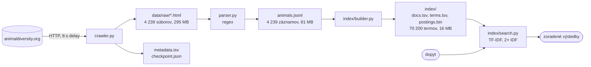

# 1. Odovzdanie – Vyhľadávač živočíšnych druhov (Animal Diversity Web)

> Termín 28.10.2026. DokuWiki: `user:jozef.ziduliak:1.odovzdanie`. Kód: https://github.com/JozefZiduliak/vinf (tag `v0.5.0`).

## 1. Opis projektu a cieľ

Cieľom je vyhľadávač živočíšnych druhov postavený od nuly: vlastný crawler, extrakcia regexom, vlastný invertovaný index a TF-IDF ranking. Dáta sú účty druhov z Animal Diversity Web (ADW), kde má každý druh stránku s rovnakou šablónou sekcií. Z každej stránky berieme 5 atribútov (taxonómia, geografický rozsah, habitat, potrava, stav ohrozenia IUCN) a plný text. Používateľ zadá voľný text, napríklad „nocturnal desert rodent", a dostane zoradený zoznam druhov s atribútmi.

Motivácia: cieľom je prejsť celým IR pipeline vlastnými rukami, od crawlera po ranking, a vidieť, kde čisté TF-IDF stačí a kde nie. Živočíchy sú na to vhodná doména: každá stránka má rovnakú šablónu, takže sa dá spracovať regexom, kombinuje voľný text so štruktúrovanými štítkami (habitat, potrava, IUCN), a vedecké meno je jednoznačný kľúč na spojenie s Wikipédiou. Vyhľadávanie ADW nám v závere poslúži ako referencia na porovnanie. V druhej časti semestra záznamy spojíme cez vedecké meno s článkami z anglickej Wikipédie (Spark nad dumpom) a index prebudujeme v PyLucene.

Pipeline má štyri kroky, každý číta výstup predchádzajúceho:



Spúšťanie: `uv run dev crawl | parse | build-index | search "dopyt" | show <slug> | stats`.

## 2. Scrapované stránky a extrahované dáta

Doména: https://animaldiversity.org (University of Michigan). Dokument = účet druhu `/accounts/<Genus_species>/`, napríklad https://animaldiversity.org/accounts/Panthera_leo/ . Stránky sú čisté HTML bez JavaScriptu, robots.txt povoľuje `/accounts/` a žiada `Crawl-delay: 8`.

Z každého účtu extrahujeme vedecké meno, bežný názov, taxonómiu (Kingdom až Genus), štítky Biogeographic Regions (rozsah), Habitat Regions + Terrestrial Biomes (habitat), Primary Diet (potrava), kategóriu IUCN Red List a text všetkých sekcií (Geographic Range, Habitat, Physical Description, Reproduction, Behavior, Food Habits, Conservation Status, ...).

Päť ukážok z `data/animals.jsonl`:

| Vedecké meno | Bežný názov | Trieda / rad / čeľaď | Rozsah | Habitat (prvé 4) | Potrava | IUCN | Slov v texte |
|---|---|---|---|---|---|---|---|
| Panthera leo | lion | Mammalia / Carnivora / Felidae | palearctic, oriental, ethiopian | temperate, tropical, terrestrial, savanna or grassland | carnivore | Vulnerable | 3 417 |
| Melopsittacus undulatus | budgerigar | Aves / Psittaciformes / Psittacidae | nearctic, australian | savanna or grassland, forest | herbivore | Least Concern | 997 |
| Ornithorhynchus anatinus | duck-billed platypus | Mammalia / Monotremata / Ornithorhynchidae | australian | temperate, tropical, terrestrial, freshwater | carnivore | No special status | 1 281 |
| Carcharodon carcharias | Great white shark | Chondrichthyes / Lamniformes / Lamnidae | indian ocean, atlantic ocean, pacific ocean | temperate, tropical, saltwater or marine | carnivore | Vulnerable | 2 118 |
| Apis mellifera | honey bee | Insecta / Hymenoptera / Apidae | nearctic, palearctic, oriental, ethiopian, neotropical, australian | temperate, tropical, terrestrial, desert or dune | herbivore | No special status | 4 424 |

Jeden záznam v JSONL (skrátený):

```json
{"slug": "Ornithorhynchus_anatinus", "scientific_name": "Ornithorhynchus anatinus",
 "common_name": "duck-billed platypus",
 "taxonomy": {"Kingdom": "Animalia", "Phylum": "Chordata", "Class": "Mammalia", "Order": "Monotremata", "Family": "Ornithorhynchidae", "Genus": "Ornithorhynchus"},
 "conservation_status": "No special status",
 "range": ["australian"], "habitat": ["temperate", "tropical", "terrestrial", "freshwater"], "diet": ["carnivore"],
 "sections": {"geographic_range": "The geographic range of Ornithorhynchus anatinus is restricted to the wetter regions of eastern Australia and Tasmania. ...", "habitat": "...", ...},
 "text": "The geographic range of ..."}
```

Pokrytie atribútov na celom korpuse (4 239 dokumentov):

| Atribút | Dokumentov | Podiel |
|---|---|---|
| taxonómia | 4 239 | 100 % |
| plný text | 4 239 | 100 % |
| geografický rozsah | 4 198 | 99,0 % |
| IUCN status | 4 177 | 98,5 % |
| habitat | 4 001 | 94,4 % |
| bežný názov | 3 597 | 84,9 % |
| potrava | 3 523 | 83,1 % |

Chýbajúce hodnoty som overil systematicky, nie na vzorke: pre každý atribút som vzal všetky dokumenty bez hodnoty a v ich surovom HTML hľadal značku, z ktorej regex ťahá. Kontrola odhalila dva varianty šablóny, ktoré regexy nepoznali, a opravil som ich: status `Not Evaluated` je na 40 stranách v `<dd>` bez `<span>` a tagy bez hesla v glosári (indian ocean, mediterranean sea, icecap) sú obyčajný `<span>` namiesto odkazu. Zvyšné chýbajúce hodnoty na stránke naozaj nie sú (napr. 62 strán nemá sekciu Conservation Status vôbec). Rozdelenie IUCN: Least Concern 2 104, No special status 455, Not Evaluated 424, Vulnerable 316, Endangered 244, Near Threatened 239, Critically Endangered 149, Data Deficient 133, staré kategórie Lower Risk 90, Extinct 23.

## 3. Príklady dopytov a odpovedí

Dopyt je voľný text, odpoveď je zoradený zoznam druhov so skóre, bežným názvom, taxonómiou, IUCN statusom a termami dopytu, ktoré dokument obsahuje. Stĺpec „Reálne" je výstup aktuálnej verzie (classic IDF, bez stemmingu).

| # | Dopyt | Očakávaná odpoveď | Reálne (top 1) | Čo testuje |
|---|---|---|---|---|
| 1 | Panthera leo | Panthera leo, potom ostatné druhy rodu Panthera | Panthera pardus (leopard), lev až druhý | presná zhoda mena; leopard má kratší text a leva v ňom spomína často, mená budú mať vlastné pole v Lucene |
| 2 | australia parrot popular pet | Melopsittacus undulatus (budgerigar) | Amazona autumnalis, andulka 6. | voľný text + rozsah; na stránke je „Australian", nie „australia" |
| 3 | lions in africa | Panthera leo | Panthera leo, potom uškatce (sea lion) | vyhľadávač pracuje s jednotlivými slovami, nevie, že „sea lions" nie sú levy |
| 4 | hibernates during winter | Ursus americanus, Marmota, Tamias | Dolichovespula arenaria (osa), Rana cascadae | voľný text z Behavior, bez atribútov |
| 5 | nocturnal desert rodent | Dipodomys, Chaetodipus | Dipsosaurus dorsalis (leguán), 3. Sciurus yucatanensis | tri atribúty; „desert" má najväčšiu váhu, lebo je najzriedkavejší |
| 6 | mammal that lays eggs | Ornithorhynchus anatinus, Tachyglossus aculeatus | Fasciola hepatica (motolica), vtákopysk mimo top 100 | vtákopysk má v texte „lay eggs" a „egg-laying", nie „lays eggs" |

Dopyty 1, 2 a 6 ukazujú limity čistého TF-IDF nad jedným textovým poľom: žiadne frázy, žiadne synonymá, žiadna váha pre meno. Presne toto riešia fieldy a frázové dopyty v PyLucene v tretej časti.

## 4. Frameworky a knižnice

Python 3.14 cez `uv`, deklarované `requires-python >= 3.11`. V prvej časti zámerne bez vyhľadávacích knižníc, index a ranking sú vlastné.

| Knižnica | Použitie |
|---|---|
| `requests` | HTTP GET s hlavičkami a timeoutom, `allow_redirects=False` (302 = druh bez účtu) |
| `re` (stdlib) | extrakcia odkazov v crawleri, extrakcia atribútov a textu v parseri, tokenizácia |
| `urllib.robotparser` (stdlib) | `can_fetch()`, `crawl_delay()` z robots.txt |
| `collections.deque`, `Counter`, `defaultdict` (stdlib) | fronta BFS, term frequency, postings |
| `json`, `csv`, `pathlib`, `logging` (stdlib) | checkpoint, metadáta TSV, index na disku, logy so štatistikami |
| `pydantic` | model `Animal`, validácia a serializácia do JSONL, spätné načítanie v indexeri |
| `html.unescape`, `math` (stdlib) | entity `&amp;` v texte, `log` v IDF |
| `tiktoken` | len štatistika počtu LLM tokenov (bonus) |
| `pytest`, `ruff` (dev) | unit testy regexov, lint |

## 5. Architektúra crawlera

{{user:jozef.ziduliak:crawler_hld.png?700}}

Crawler je BFS prechod taxonomického stromu ADW od koreňa `/accounts/Animalia/classification/`. Klasifikačné stránky sa spracúvajú do šírky, účty druhov (listy) majú prednosť a sťahujú sa hneď po objavení. Stav drží fronta `deque` a množina `seen` (URL pridané do fronty, bráni duplicitám a cyklom cez odkazy na predkov). Jedna iterácia:

1. vyber URL z fronty, over `robots.txt` cez `can_fetch()`,
2. stiahni (GET, hlavičky, timeout 15 s, 3 pokusy, bez presmerovaní), spi 8 s,
3. klasifikačná stránka: regexom vyber odkazy (cesta, rank, príznak `feature-less`); prázdne podstromy orež bez requestu; druhy preveď na URL účtu a daj na začiatok fronty; ostatné taxóny na koniec,
4. účet druhu so statusom 200: ulož HTML do `data/raw/<Genus_species>.html`,
5. každú URL zapíš do `metadata.tsv`, ulož checkpoint (fronta + seen) atomicky cez dočasný súbor a `os.replace`.

Pri štarte sa checkpoint načíta a crawler pokračuje, kde skončil. Bežal na Raspberry Pi 4 v `tmux` tri dni s viacerými prerušeniami.

Kľúčové zistenie: strom má ~200 000 uzlov, ale účet má len 4 239 druhov. Druh bez účtu vráti 302, uzly bez obsahu majú triedu `<div class="feature-less">` na každej úrovni. Orezávanie `feature-less` podstromov preskočilo 194 800 uzlov bez requestu a skrátilo crawl z odhadovaných týždňov na ~30 h.

## 6. Metadáta ukladané pri crawlovaní

Každá spracovaná URL má riadok v `data/metadata.tsv` (211 358 riadkov, z toho 194 800 orezaných uzlov bez requestu):

| url | type | status | timestamp | size | file |
|---|---|---|---|---|---|
| /accounts/Panthera/classification/ | classification | 200 | 2026-09-27T21:21:53 | 15569 | |
| /accounts/Panthera_leo/ | species | 200 | 2026-09-27T21:22:27 | 114255 | data/raw/Panthera_leo.html |
| /accounts/Lycorma_delicatula/ | species | 200 | 2026-10-03T13:02:16 | 64162 | data/raw/Lycorma_delicatula.html |
| /accounts/Lycorma_meliae/classification/ | pruned_species | | 2026-10-03T13:02:07 | 0 | |
| /accounts/Clathrina_heronensis/ | species | 302 | 2026-09-26T12:26:27 | 0 | |

`type` rozlišuje navigáciu, uložený účet a orezaný uzol (s rankom), `status` je HTTP kód (302 = druh bez účtu), `size` je veľkosť odpovede v bajtoch. Z tejto tabuľky sú všetky čísla v sekcii 13 a vieme z nej, ktoré URL treba pri retry skúsiť znova (status 0 = sieťová chyba).

## 7. Hlavičky, timeout, sleep

```python
CONTACT_EMAIL = "xziduliak@stuba.sk"
USER_AGENT = f"vinf-crawler/0.1 (FIIT STU student project; {CONTACT_EMAIL})"
HEADERS = {"User-Agent": USER_AGENT, "From": CONTACT_EMAIL, "Accept": "text/html"}
TIMEOUT = 15
DELAY_SECONDS = 8      # fallback, reálne sa číta z robots.txt
MAX_RETRIES = 3
```

- **User-Agent** a **From** identifikujú bota, projekt a kontakt, aby správca stránky mohol napísať namiesto blokovania. **Accept: text/html** hovorí, že nechceme obrázky ani JSON.
- **Sleep 8 s** je `Crawl-delay: 8` z robots.txt, načítané cez `RobotFileParser.crawl_delay()`. Spí sa po každom requeste, aj neúspešnom. Pri 16 557 requestoch to je ~37 h čistého čakania, preto checkpoint a Raspberry Pi.
- **Timeout 15 s**: bežná odpoveď je pod 1 s, 15 s je porucha, nie pomalosť. Bez timeoutu by `requests.get` pri výpadku visel.
- **Retry 3×** len pri sieťovej chybe alebo 5xx. Pri 404 a 302 sa neopakuje, výsledok sa nezmení.
- **robots.txt**: každá URL ide pred requestom cez `can_fetch()`; zakázané cesty (`/mousetrap/`, `/workspaces/`, `/quaardvark/search/`) regex nikdy nevyberie.

## 8. Extrakcia URL z HTML

Reálny kód z `src/crawler.py` (https://github.com/JozefZiduliak/vinf/blob/main/src/crawler.py):

```python
LINK_RE = re.compile(
    r'<div ?(class="feature-less")?>\s*(?:<span>\w+</span>)?\s*'
    r'<a href="(/accounts/[A-Za-z_]+/classification/)" class="taxon-link rank--(\w+)"'
)

def extract_links(html: str) -> list[tuple[str, str, str]]:
    return list(dict.fromkeys(LINK_RE.findall(html)))
```

Regex vracia trojicu (príznak `feature-less`, cesta, rank). Kotví sa na triede `taxon-link`, takže odkazy na obrázky, zvuky alebo vyhľadávanie nikdy nezachytí. `dict.fromkeys` odstráni duplicity a zachová poradie.

## 9. Extrakcia entít z HTML

Reálny kód z `src/parser.py` (https://github.com/JozefZiduliak/vinf/blob/main/src/parser.py). Šesť regexov, každý kotvený na stabilný kus šablóny ADW:

```python
SCIENTIFIC_NAME_RE = re.compile(r'<h1 class="rank--Species">\s*([^<]+?)\s*</h1>')
VERNACULAR_NAME_RE = re.compile(r'<p class="vernacular-name">\s*([^<]+?)\s*</p>')

# one row of the Classification table: rank label + linked taxon name
TAXONOMY_RE = re.compile(
    r'<span class="rank-label">\s*(\w+)\s*</span>\s*</td>\s*<td>\s*'
    r'<a class="taxon-link rank--\w+" href="[^"]+">\s*([^<]+?)\s*</a>'
)
# two markups: <dd><span>Vulnerable</span> on most pages, <dd>Not Evaluated</dd> on ~40
IUCN_RE = re.compile(
    r'IUCN Red List.{0,200}?</dt>\s*<dd>\s*(?:<span>\s*)?([^<]+?)\s*<', re.DOTALL
)

# text sections: <section><h2 id="food_habits">...</h2> body </section>
SECTION_RE = re.compile(r'<h2 id="(\w+)">.*?</h2>(.*?)</section>', re.DOTALL)
SKIP_SECTIONS = {"comments", "contributors", "references", "label"}

# keyword tags: a header, then items until the next header or end of section
TAG_BLOCK_RE = re.compile(
    r'<li class="keywords-header">\s*([^<]+?)\s*</li>(.*?)(?=<li class="keywords-header">|</section>)',
    re.DOTALL,
)
# tags with a glossary entry are links, tags without one are plain <span>s
TAG_ITEM_RE = re.compile(
    r'(?:popover-replace" href="[^"]+"|<span)>\s*([^<]+?)\s*</(?:a|span)>'
)


def parse_animal(html: str, slug: str) -> Animal:
    tags = extract_tags(html)
    sections = {
        sid: clean(body)
        for sid, body in SECTION_RE.findall(html)
        if sid not in SKIP_SECTIONS
    }
    return Animal(
        slug=slug,
        scientific_name=first(SCIENTIFIC_NAME_RE, html) or slug.replace("_", " "),
        common_name=first(VERNACULAR_NAME_RE, html),
        taxonomy=dict(TAXONOMY_RE.findall(html)),
        conservation_status=first(IUCN_RE, html),
        range=tags.get("Biogeographic Regions", []),
        habitat=tags.get("Habitat Regions", []) + tags.get("Terrestrial Biomes", []),
        diet=tags.get("Primary Diet", []),
        sections=sections,
        text=" ".join(sections.values()),
    )
```

`clean()` odstráni tagy, dekóduje entity a zlúči biele znaky; `extract_tags()` spája dvojkrokový regex štítkov do slovníka `{"Primary Diet": ["carnivore"], ...}`. Štítky sú na stránke dvakrát (`<a>` a `<button>`), berieme len `<a>`. Celý korpus sa parsuje za 3,8 s. Zistenia z testov: hmyz nemá v tabuľke riadok Phylum, salamandry nemajú Order, takže taxonómia nie je uniformná a model ju drží ako slovník.

## 10. Indexer a index (TF)

Kód: `src/index/tokenizer.py`, `src/index/builder.py`, `src/index/storage.py`. Index je invertovaný: `term → {dokument: tf}`. Tokenizácia je jedna funkcia pre dokumenty aj dopyty, inak by sa rozišli:

1. `lower()`,
2. `[a-z0-9]+` rozseká text na slová, interpunkcia zmizne,
3. odstránenie 60 anglických stop-slov (ručný zoznam, bez NLTK),
4. voliteľne naivný stemming (odrezanie `ies`, `ing`, `ed`, `es`, `s`, slová do 4 znakov sa nemenia).

Indexované pole = vedecké meno + bežný názov + štítky + plný text, spojené do jedného reťazca. Štítok „carnivore" sa v texte často nevyskytuje, takto je hľadateľný.

```python
for line in INPUT_FILE:
    animal = Animal.model_validate_json(line)
    tokens = tokenize(document_text(animal), use_stem)
    doc_lengths[animal.slug] = len(tokens)
    for term, tf in Counter(tokens).items():
        postings[term][animal.slug] = tf
```

### Formát indexu na disku

Prvá verzia (v0.4.1) ukladala celý index ako jeden JSON (60 MB). Po konzultácii K2b sme formát zmenili na tri súbory v `data/index/plain/` (so stemmingom `data/index/stem/`), aby sa pri dopyte nečítal celý index:

| súbor | čo obsahuje | kedy sa číta |
|---|---|---|
| `docs.tsv` | jeden riadok na dokument: id (číslo riadku), slug, dĺžka v tokenoch, dve normy pre kosínus, uložené polia pre výpis (bežný názov, rad, čeľaď, IUCN) | pri štarte, celý |
| `terms.tsv` | jeden riadok na term: term, df, offset (pozícia v bajtoch, kde v `postings.bin` začína jeho zoznam) | pri štarte, celý |
| `postings.bin` | pre každý term `df` záznamov po 6 bajtoch: id dokumentu (4 bajty), tf (2 bajty); záznamy jedného termu sú za sebou | pri dopyte, len termy dopytu |

Skutočné riadky:

```
docs.tsv
id    slug                     len   norm_raw  norm_log  name        order           family       status
2377  Melopsittacus_undulatus  721   41.9881   29.4829   budgerigar  Psittaciformes  Psittacidae  Least Concern
2645  Neopsephotus_bourkii     929   64.6916   33.5930   Bourke's parrot  Psittaciformes  Psittacidae  Least Concern
2881  Panthera_leo             2396  161.2390  51.8339   lion        Carnivora       Felidae      Vulnerable

terms.tsv
term        df    offset
budgerigar  2     2275584
hibernates  31    5996250
lions       151   7341876

postings.bin, bajty 7341876 až 7342781 (151 × 6), po rozbalení:
(17, 4) (119, 2) (175, 2) ... (2881, 103) ...      id dokumentu, tf; 2881 je Panthera_leo
```

Dopyt „budgerigar" sa vyhodnotí takto: slovník dá `terms["budgerigar"] = (2, 2275584)`, teda `df = 2` a `idf = log(4239 / 2) = 7,66`. Z `postings.bin` sa prečíta 12 bajtov od pozície 2 275 584, dva páry `(2377, 2)` a `(2645, 1)`. Andulka (riadok 2377, 721 tokenov) má skóre `2 / 721 × 7,66 = 0,021`, Bourkeov papagáj (929 tokenov) `1 / 929 × 7,66 = 0,008`. Výpis doplní riadok z `docs.tsv`. Zápis a čítanie:

```python
POSTING = struct.Struct("<IH")          # doc_id uint32, tf uint16, 6 bajtov

# zápis: zoznamy termov za sebou, offset je počítadlo zapísaných bajtov
for term, plist in sorted(postings.items()):
    terms_tsv.writerow([term, len(plist), offset])
    for slug, tf in plist.items():
        postings_bin.write(POSTING.pack(doc_id[slug], tf))
    offset += len(plist) * POSTING.size

# čítanie jedného termu pri dopyte
df, offset = terms[term]
f.seek(offset)
pairs = POSTING.iter_unpack(f.read(df * POSTING.size))
```

Prečo tri súbory a nie JSON: JSON sa musí pri štarte prečítať a rozparsovať celý, aj keď dopyt použije tri termy zo 70 200. Binárny súbor s pevnou dĺžkou záznamu dovoľuje skočiť na offset termu a prečítať len jeho zoznam. Slug je v indexe raz (v `docs.tsv`), v zoznamoch je len číslo riadku. Rovnaké rozdelenie má Lucene: slovník termov zvlášť, zoznamy dokumentov zvlášť. Namerané na tom istom korpuse:

| | JSON (v0.4.1) | TSV + binárne zoznamy (v0.5.0) |
|---|---|---|
| veľkosť na disku, bez stemmingu | 60,1 MB | 15,6 MB (zoznamy 13,9, slovník 1,4, dokumenty 0,4) |
| veľkosť na disku, so stemmingom | 56,6 MB | 14,6 MB |
| načítanie pri štarte | 0,23 s | 0,04 s |
| pamäť po načítaní | 234 MB | 53 MB |
| čas stavby a zápisu | 1,0 s | 1,4 s |
| poradie výsledkov | | rovnaké pri všetkých dopytoch v sekcii 12 |

Kontrola formátu: 2 310 169 párov × 6 bajtov = 13 861 014 bajtov, presne veľkosť `postings.bin`. Pri 4 239 dokumentoch je rozdiel v rýchlosti malý; formát je navrhnutý tak, aby pri väčšom korpuse (Wikipedia v druhej časti) pamäť rástla so slovníkom, nie so zoznamami.

| | bez stemmingu | so stemmingom |
|---|---|---|
| termov v slovníku | 70 200 | 60 918 |
| tokenov | 4 329 000 | 4 329 000 |
| čas stavby | 1,4 s | 1,8 s |
| veľkosť na disku | 15,6 MB | 14,6 MB |

Index sa stavia raz po parsingu, celý od nuly, príkazom `uv run dev build-index` (prípadne `--stem` do samostatného adresára). Inkrementálne aktualizácie pri 4 239 dokumentoch a dvoch sekundách stavby nemajú zmysel. Pri hľadaní sa slovník a tabuľka dokumentov načítajú raz na proces, zoznamy sa čítajú z disku podľa termov dopytu.

Stop-slová odstránia 31 % tokenov. Skúšali sme aj doménové stop-slová: najčastejšie termy po anglickom zozname sú „native" (96,6 % dokumentov), „species" (93,6 %), „female" (92,4 %). Nepridali sme ich, lebo IDF ich váhu zníži na ~0 sám (`log(4239/4094) = 0,03`) a slová ako „range" alebo „diet" sú legitímne v dopytoch.

## 11. Výpočet skóre: IDF, TF a normalizácia dĺžky

Kód: `src/index/search.py`. Skóre dokumentu je súčet cez termy dopytu, každý sčítanec má tri časti:

```
score(d) = Σ_t  w_tf(tf(t, d)) / norm(d) × idf(t)
```

- `w_tf` je váha podľa počtu výskytov termu v dokumente (prepínač `--tf`),
- `norm(d)` je normalizácia dĺžky dokumentu, jedno číslo na dokument, rovnaké pre každý term (`--norm`),
- `idf(t)` je váha termu podľa toho, v koľkých dokumentoch sa vyskytuje (`--idf`).

Všetko sa počíta pri dopyte z `N`, `df` a hodnôt v `docs.tsv`, index nie je viazaný na jeden vzorec. Každý prepínač mení jednu časť, ostatné dve ostávajú.

### IDF

Zadanie žiada aspoň dve metódy, pravdepodobnostný IDF sa nepočíta. Povinné dve sú `classic` a `smooth`, ďalšie dve sú navyše.

```python
def idf_classic(n: int, df: int) -> float:
    return math.log(n / df)

def idf_smooth(n: int, df: int) -> float:
    return 1 + math.log(n / (1 + df))

def idf_unary(n: int, df: int) -> float:
    return 1.0

def idf_bm25(n: int, df: int) -> float:
    return math.log((n - df + 0.5) / (df + 0.5))
```

- **classic** `log(N / df)`: pôvodný vzorec (Spärck Jones 1972, Manning IIR 6.2.1). Term, ktorý je vo všetkých dokumentoch, má váhu 0, zriedkavý term vysokú.
- **smooth** `1 + log(N / (1 + df))`: vzorec z klasickej Lucene (`TFIDFSimilarity`). Pripočítaná jednotka znamená, že žiadny term neklesne pod váhu 1, ani keď je vo všetkých dokumentoch; `1 + df` chráni pred delením nulou pri terme, ktorý v indexe nie je.
- **unary** `1`: bez IDF, každý term rovnako. Nie je to súťažiaca metóda, ale kontrola: ukáže, čo IDF do poradia pridáva.
- **bm25** `log((N − df + 0,5) / (df + 0,5))`: pravdepodobnostný vzorec (Robertson a Spärck Jones, Manning IIR 11.4.3). Bol v prvej verzii, nechali sme ho ako doplnok, medzi dve povinné metódy ho nepočítame. Pre termy vo viac než polovici dokumentov je záporný.

IDF vybraných termov na našom korpuse (N = 4 239), od najvzácnejšieho po najbežnejší. Nie sú to skóre dokumentov, len váhy slov:

| term | df | classic | smooth | unary | bm25 |
|---|---|---|---|---|---|
| budgerigar | 2 | 7,66 | 8,25 | 1 | 7,44 |
| hibernates | 31 | 4,92 | 5,89 | 1 | 4,89 |
| lions | 151 | 3,33 | 4,33 | 1 | 3,30 |
| africa | 710 | 1,79 | 2,79 | 1 | 1,60 |
| winter | 1 635 | 0,95 | 1,95 | 1 | 0,47 |
| eggs | 2 592 | 0,49 | 1,49 | 1 | −0,45 |
| during | 3 526 | 0,18 | 1,18 | 1 | −1,60 |
| native | 4 094 | 0,03 | 1,03 | 1 | −3,34 |

Classic a smooth sa líšia takmer presne o 1. Rozdiel je v pomere: „native" má v classic váhu 0,03, prakticky nulu, v smooth 1,03, teda stále celú jednotku. V smooth má bežné slovo štvrtinu váhy zriedkavého slova „lions", v classic stotinu. To rozhoduje v sekcii 12.

### Váha TF

- **raw** `tf`: počet výskytov. Dvadsať výskytov je dvadsaťkrát viac než jeden.
- **log** `1 + log(tf)`: logaritmický TF (Manning IIR 6.4.1). Prvý výskyt má váhu 1, desať výskytov 3,3, sto výskytov 5,6. Každé ďalšie opakovanie pridáva menej.

### Normalizácia dĺžky dokumentu

Bez normalizácie dlhý dokument vyhrá vždy, lebo má viac slov a teda vyššie tf. `norm(d)` je číslo, ktorým sa tf delí:

| `--norm` | vzorec | čo meria |
|---|---|---|
| none | 1 | nič, surové tf |
| len | počet tokenov dokumentu | výskyty na jedno slovo |
| cosine | √(Σ tf²) cez všetky termy dokumentu | aká časť obsahu dokumentu je tento term; vektorový model, kosínus uhla medzi dokumentom a dopytom (Manning IIR 6.3) |
| pivot | (1 − b) + b × len(d) / avg_len, b = 0,75 | ako `len`, ale priemerný dokument má 1 a odchýlky sú tlmené na 75 % (Singhal 1996, rovnaké b ako v BM25) |

Kosínusová norma potrebuje všetky termy dokumentu, nie len termy dopytu, preto sa počíta pri stavbe indexu a ukladá do `docs.tsv` (stĺpce `norm_raw` a `norm_log`; pre `--tf log` má vektor iné súradnice, takže má vlastnú normu). Pri dopyte sa hodnoty len vyhľadajú. Príklad, priemerná dĺžka dokumentu je 1 021 tokenov:

| dokument | len | cosine (raw) | pivot |
|---|---|---|---|
| lev, Panthera leo | 2 396 | 161,2 | 2,01 |
| andulka, Melopsittacus undulatus | 721 | 42,0 | 0,78 |
| osa, Dolichovespula arenaria | 267 | 22,2 | 0,45 |

Prepínače pri hľadaní: `--idf classic|smooth|unary|bm25` (default classic), `--tf raw|log` (default raw), `--norm none|len|cosine|pivot` (default len), `--stem` (stemovaný index).

## 12. Porovnanie IDF metód na dopytoch

Pri každom dopyte najprv píšeme, čo očakávame, potom čo vyšlo. `uv run dev search "<dopyt>" --top-k 5 --idf <metóda>`, ostatné prepínače default (`--tf raw --norm len`). V zátvorke termy dopytu nájdené v dokumente. Stĺpec unary ukazuje poradie bez IDF.

**Dopyt 1: „lions in africa"** (df 151 a 710, oba termy zriedkavé). Očakávanie: lev prvý pri každej metóde, IDF nemá čo rozhodovať.

| # | classic | smooth | unary | bm25 |
|---|---|---|---|---|
| 1 | 0,150 lev (lions, africa) | 0,197 lev | 0,047 lev | 0,148 lev |
| 2 | 0,127 uškatec Stellerov (lions) | 0,165 uškatec Stellerov | 0,038 uškatec Stellerov | 0,125 uškatec Stellerov |
| 3 | 0,110 uškatec novozélandský (lions) | 0,143 uškatec novozélandský | 0,033 uškatec novozélandský | 0,109 uškatec novozélandský |
| 4 | 0,106 uškatec galapážsky (lions) | 0,138 uškatec galapážsky | 0,032 uškatec galapážsky | 0,105 uškatec galapážsky |
| 5 | 0,073 puma (lions) | 0,095 puma | 0,022 puma | 0,072 puma |

Rovnaké poradie pri všetkých štyroch, aj bez IDF. Pri dvoch zriedkavých termoch rozhoduje `tf / len`, IDF len škáluje skóre. Lev je jediný dokument s oboma termami. Uškatce sú druhé, lebo „sea lion" obsahuje slovo „lions"; vyhľadávač pracuje s jednotlivými slovami, nie so slovnými spojeniami.

**Dopyt 2: „native carnivore"** („native" je v 96,6 % dokumentov, „carnivore" v 47 %). Očakávanie: dobrá metóda „native" takmer ignoruje a hore sú mäsožravce; metóda, ktorá dá „native" váhu, pustí hore dokumenty, kde sa „native" len často opakuje.

| # | classic | smooth | unary | bm25 |
|---|---|---|---|---|
| 1 | 0,0088 Rhinoderma darwinii, žaba (native, carnivore) | 0,0388 Onthophagus australis, lajniak (native) | 0,0375 Onthophagus australis (native) | 0,0006 delfín bieloňosý (carnivore) |
| 2 | 0,0084 Amorphochilus schnablii, netopier (native, carnivore) | 0,0259 Lagenodelphis hosei, delfín (native, carnivore) | 0,0238 Cryptochiton stelleri, chitón (native) | 0,0006 Sinea diadema, bzdocha (carnivore) |
| 3 | 0,0077 Catopuma badia, mačka (native, carnivore) | 0,0256 Rhinoderma darwinii (native, carnivore) | 0,0231 Limulus polyphemus, ostrorep (native) | 0,0005 Gasterophilus intestinalis, strečok (carnivore) |
| 4 | 0,0067 Choerodon fasciatus, ryba (native, carnivore) | 0,0246 Cryptochiton stelleri (native) | 0,0214 Fasciola hepatica, motolica (native) | 0,0005 Strongylus vulgaris, hlísta (carnivore) |
| 5 | 0,0064 Lagenodelphis hosei, delfín (native, carnivore) | 0,0244 Amorphochilus schnablii (native, carnivore) | 0,0208 Urticina felina, sasanka (native) | 0,0005 Trichuris trichiura, tenkohlavec (carnivore) |

Classic: „native" má váhu 0,03 a „carnivore" 0,76, vyhrajú dokumenty s oboma termami, všetkých päť sú mäsožravce. Smooth: „native" má 1,03 a „carnivore" 1,76, bežné slovo má 60 % váhy zriedkavého. Krátky dokument o lajniakovi, kde sa „native" opakuje a „carnivore" nie je vôbec, predbehne mäsožravce. Unary je to isté bez IDF: päť dokumentov len s „native". Bm25 dá „native" −3,34, každý dokument s ním ide do mínusu a vyhrajú dokumenty len s „carnivore". Tu je classic najlepší, smooth sa správa spolovice ako unary.

**Dopyt 3: „hibernates during winter"** („during" v 83 % dokumentov, „winter" v 39 %, „hibernates" v 0,7 %). Očakávanie: hore majú byť zvieratá s termom „hibernates", slovo „during" nemá rozhodovať.

| # | classic | smooth | unary | bm25 |
|---|---|---|---|---|
| 1 | 0,0256 osa Dolichovespula arenaria (hibernates, winter) | 0,0450 oriešok, winter wren (during, winter) | 0,0250 Onthophagus australis (during, winter) | 0,0218 osa (hibernates, winter) |
| 2 | 0,0214 oriešok (during, winter) | 0,0384 vačkovec Pseudochirops archeri (during, winter) | 0,0243 snehuľa Lagopus leucura (during, winter) | 0,0108 žaba Rana cascadae (hibernates, during, winter) |
| 3 | 0,0174 žaba Rana cascadae (hibernates, during, winter) | 0,0381 snehuľa Lagopus leucura (during, winter) | 0,0236 oriešok (during, winter) | 0,0096 syseľ Beldingov (hibernates, winter) |
| 4 | 0,0173 vačkovec Pseudochirops archeri (during, winter) | 0,0367 osa (hibernates, winter) | 0,0232 piskor Anourosorex squamipes (during, winter) | 0,0081 oriešok (during, winter) |
| 5 | 0,0138 snehuľa Lagopus leucura (during, winter) | 0,0347 piskor Anourosorex squamipes (during, winter) | 0,0215 strnádka Zonotrichia atricapilla (during, winter) | 0,0055 lumík Dicrostonyx (winter) |

Classic: osa prvá (hibernates + winter), žaba tretia, ale oriešok druhý len vďaka 32 výskytom „winter" (má ho v mene). Smooth: jediné hibernujúce zviera v top 5 je osa na štvrtom mieste. Vyhrávajú dokumenty s „during" + „winter", lebo tieto bežné slová dostali 1,18 a 1,95 namiesto 0,18 a 0,95, kým „hibernates" stúplo len z 4,92 na 5,89. Unary: päť dokumentov s bežnými slovami, žiadne nehibernuje. Bm25: tri hibernujúce zvieratá na prvých troch miestach, „during" má zápornú váhu.

Prepočet pre oriešok (1 441 tokenov, „winter" 32×, „during" 2×, „hibernates" 0×) a žabu (347 tokenov, každý term 1×), `tf / len × idf` po termoch:

| | oriešok classic | oriešok smooth | žaba classic | žaba smooth |
|---|---|---|---|---|
| hibernates | 0 | 0 | 1/347 × 4,92 = +0,0142 | 1/347 × 5,89 = +0,0170 |
| during | 2/1441 × 0,18 = +0,0002 | 2/1441 × 1,18 = +0,0016 | +0,0005 | +0,0034 |
| winter | 32/1441 × 0,95 = +0,0211 | 32/1441 × 1,95 = +0,0433 | +0,0027 | +0,0056 |
| **skóre** | **0,0214** | **0,0450** | **0,0174** | **0,0260** |

V classic je žaba blízko oriešku, jeden výskyt „hibernates" takmer vyváži 32 výskytov „winter". V smooth sa príspevok „winter" zdvojnásobil a žaba (0,026) vypadla z top 5.

**Zhrnutie IDF**: pri dopytoch zo zriedkavých slov sú všetky metódy rovnaké. Rozdiel robia bežné slová v dopyte. Classic ich váhu stiahne k nule, čo v oboch problémových dopytoch dalo najlepšie poradie. Smooth drží každé slovo aspoň na váhe 1; to je návrh pre malé kolekcie a jednoslovné dopyty, pri našich dopytoch bežné slová zvýhodnil. Bm25 bežné slová trestá záporne, čo pomohlo pri „hibernates", ale záporné skóre sa ťažko vysvetľuje a dokument so všetkými termami dopytu môže skončiť pod dokumentom s jedným termom. Default ostáva classic.

### Porovnanie normalizácií dĺžky

Rovnaký výpočet (classic IDF, raw TF), mení sa len `--norm`. Pri „lions in africa" dajú všetky štyri rovnaké poradie s levom na prvom mieste, zriedkavé termy rozhodnú samy. Nižšie sú dva dopyty, kde sa normalizácie líšia.

**Dopyt „australia parrot popular pet"**. Správna odpoveď je andulka (Melopsittacus undulatus), austrálsky papagáj a najchovanejší vták na svete. Otázka: ktorá normalizácia ju dostane najvyššie? Pozícia andulky: none 18., len 6., pivot 8., cosine 5.

| # | none | len | cosine | pivot |
|---|---|---|---|---|
| 1 | 101,8 amazoňan červenočelý (parrot, popular, pet) | 0,161 amazoňan červenočelý | 2,219 amazoňan červenočelý | 142,6 amazoňan červenočelý |
| 2 | 44,7 amazoňan cisársky (parrot, pet) | 0,040 Ashbyia lovensis, spevavec (australia) | 0,744 amazoňan cisársky | 40,6 amazoňan cisársky |
| 3 | 44,2 bandikut králikovitý (australia) | 0,039 amazoňan cisársky | 0,587 mníšok sivý (parrot, pet) | 37,9 papagáj Bourkeov (australia, parrot, pet) |
| 4 | 41,9 Pionites leucogaster, papagáj (parrot, pet) | 0,038 papagáj Bourkeov (australia, parrot, pet) | 0,547 papagáj Bourkeov | 31,5 mníšok sivý |
| 5 | 35,4 papagáj Bourkeov (australia, parrot, pet) | 0,037 mníšok sivý (parrot, pet) | **0,500 andulka (australia, parrot, pet)** | 29,5 Ashbyia lovensis (australia) |

Amazoňan červenočelý vyhráva všade: „parrot" 20× v texte (df 33, idf 4,86) nič neprebije. Andulka má „parrot" 2×, „australia" 4×, „pet" 1×. Dĺžky oboch sú podobné (721 a 631 tokenov), takže `len` ani `pivot` medzi nimi nerozhodnú, a navyše pustia hore krátke dokumenty s jediným slovom dopytu (spevavec Ashbyia len s „australia"). Kosínus meria dĺžku vektora, ktorá rastie s opakovaním: amazoňan má normu 45,9 (20 výskytov sa počíta na druhú), andulka 42,0, a krátke dokumenty s jedným bežným slovom kosínus netlačí hore tak ako `len`. Preto je andulka v top 5 len pri kosíne.

**Dopyt „hibernates during winter"**. Otázka: ktorá normalizácia udrží hore zvieratá s termom „hibernates"? Pozícia osy (hibernates, winter): len 1., cosine 2., pivot 3., none mimo top 30. Žaba Rana cascadae (všetky tri termy): len 3., cosine 4., pivot 7., none mimo top 30.

| # | none | len | cosine | pivot |
|---|---|---|---|---|
| 1 | 30,9 oriešok (during, winter) | 0,0256 osa (hibernates, winter) | 0,348 oriešok | 23,6 oriešok |
| 2 | 19,2 škrečok Roborovského (during, winter) | 0,0214 oriešok | 0,307 osa | 16,5 vačkovec |
| 3 | 18,3 snehuľa kapcavá (during, winter) | 0,0174 žaba (hibernates, during, winter) | 0,254 vačkovec | 15,3 osa |
| 4 | 15,1 netopier Myotis grisescens (hibernates, during, winter) | 0,0173 vačkovec | 0,247 žaba | 13,7 snehuľa |
| 5 | 13,9 vačkovec (during, winter) | 0,0138 snehuľa | 0,222 snehuľa | 12,4 syseľ Franklinov (hibernates, during, winter) |

Bez normalizácie vyhrávajú dlhé dokumenty s mnohými výskytmi „winter" (oriešok, 1 441 tokenov). `len` delí krátku osu (267 tokenov) malým číslom a dá jej prvé miesto. Kosínus a pivot osu zvýhodnia menej (norma 22,2 namiesto 267; pivot 0,45 oproti priemeru 1) a oriešok s 32 výskytmi „winter" sa vráti na prvé miesto. Pivot sa správa ako slabší `len`: rovnaká logika, menšie rozdiely.

**Zhrnutie normalizácií**: `none` nie je použiteľné, dlhé dokumenty vyhrajú vždy. `len` najviac zvýhodňuje krátke dokumenty, čo pomohlo pri hibernácii (osa) a uškodilo pri papagájoch (spevavec len s „australia"). Kosínus ako jediný dostal andulku do top 5 a pri hibernácii dal rozumné poradie. Pivot bol pri našich dopytoch vždy medzi `none` a `len`. Default necháme `len`, lebo skóre `tf / len × idf` sa dá prepočítať ručne; kosínus je kandidát na default po vyhodnotení na viac dopytoch.

### Doplnkový experiment 1: stemming

Rovnaký výpočet skóre (classic IDF), ale dopyty bežia nad druhým indexom, kde boli dokumenty aj dopyt stemované (`--stem`):

| Dopyt | Bez stemmingu (poradie: dokument) | So stemmingom |
|---|---|---|
| lions in africa | 1. lev (0,150), 2. uškatec (0,127) | 1. lev (0,168), 2. uškatec (0,129); poradie rovnaké, „lion" a „lions" sú jeden term, lev získal viac |
| hibernates during winter | 1. osa, 2. oriešok (winter wren) | 1. oriešok, 2. osa; termy „hibernat", „dur" (stemmer odrezal „ing" z „during", ktoré nie je sloveso) |
| nocturnal desert rodent | 2. púštna korytnačka (zhoda: desert) | 2. púštna korytnačka (zhoda: desert, rodent); „rodents" → „rodent" pridalo zhodu, ale falošnú: hlodavce sú v texte ako nájomníci jej nory |
| australia parrot popular pet | 6. andulka | 16. andulka; „parrots" → „parrot" zvýhodnilo amazoňany, ktoré o papagájoch píšu všeobecne |

Naivný stemmer pomôže pri množnom čísle (lion/lions, rodent/rodents), ale nemá výnimky, takže „during" → „dur" a „hibernates" → „hibernat". Pre report nechávame default bez stemmingu; Porter stemmer by bol ďalší krok.

### Doplnkový experiment 2: logaritmický TF

Rovnaký index (bez stemmingu), ale v skóre sa namiesto `tf` použije `1 + log(tf)` (`--tf log`). Pri dopyte „australia parrot popular pet" posunul andulku zo 6. na 5. miesto, lebo amazoňan červenočelý už nevyhráva len tým, že má „parrot" 20× v texte. Pri „lions in africa" ale zhoršil výsledky: po stlmení tf prevládlo delenie dĺžkou a vyhrali krátke dokumenty s jedným výskytom „africa". Tlmenie TF teda treba ladiť spolu s normalizáciou dĺžky, čo robí plný BM25 (parametre `k1`, `b`); porovnáme s Lucene v tretej časti.

## 13. Štatistika vycrawlovaných dokumentov

`uv run dev stats` a `data/metadata.tsv`:

| | |
|---|---|
| HTTP requestov spolu | 16 557 |
| klasifikačné stránky (navigácia, neukladané) | 7 603 |
| **účty druhov uložené (HTTP 200)** | **4 239** |
| druhy bez účtu (HTTP 302) | 4 715 |
| uzly orezané bez requestu (`feature-less`) | 194 800 |
| **relevantné pre projekt** | **4 239 zo 4 239 uložených**, crawler ukladá len účty druhov |
| veľkosť `data/raw/` | 295,3 MB (priemer 70 KB / súbor) |
| veľkosť `data/animals.jsonl` | 81,3 MB |
| slov v texte | 6 196 000 (medián 1 350 / dokument) |
| IR tokenov po stop-slovách | 4 282 000 (medián 938 / dokument) |
| tiktoken tokenov (o200k_base, GPT-4o) | 8 519 000 (medián 1 872 / dokument) |
| trvanie crawlu | 26.09. – 28.09.2026 + retry 03.10., Raspberry Pi 4 |

Oficiálna stránka ADW uvádza 2 150 účtov, údaj nezmenený od roku 2014. Reálny počet je 4 239.

## 14. ZIP s kódom

{{user:jozef.ziduliak:vinf-v0.5.0.zip}} (bez dát, `git archive` tagu `v0.5.0`). Repozitár: https://github.com/JozefZiduliak/vinf

## Bonus: unit testy regex extraktorov

Súbor `tests/test_parser.py` v ZIPe zo sekcie 14 (wiki nepovoľuje prílohy `.py`), online https://github.com/JozefZiduliak/vinf/blob/v0.5.0/tests/test_parser.py . Spúšťanie `uv run pytest`, výsledok **137 passed za 0,3 s** (126 testov extraktora, 8 testov vzorcov skóre v `tests/test_search.py`, 3 testy formátu indexu v `tests/test_store.py`).

Testy bežia nad 20 stiahnutými stránkami naprieč triedami (cicavce, vtáky, ryby, hmyz, obojživelníky, plazy). Dva druhy testov:

- **zlatý štandard** pre 6 druhov (lev, andulka, včela, žralok biely, vtákopysk, piskor): ručne zapísané vedecké a bežné meno, rad, čeľaď, IUCN, potrava a rozsah sa musia presne zhodovať,
- **invarianty** na všetkých 20 stránkach: vedecké meno zodpovedá slugu, taxonómia obsahuje Kingdom/Class/Family/Genus a Kingdom je Animalia, IUCN je `None` alebo známa kategória, sekcie obsahujú `geographic_range`, v texte nezostal žiadny HTML tag ani `&amp;` ani dvojitá medzera, štítky nie sú prázdne, `text` je spojenie sekcií.

Testy odhalili, že hmyz nemá riadok Phylum a salamandry nemajú Order, a že včela má v texte literál `<<g.Pan>>` (chyba na ADW, nie neodstránený tag).

## Bonus: počet tokenov

V tabuľke v sekcii 13: 8 519 000 tokenov tiktoken `o200k_base` (tokenizér GPT-4o), medián 1 872 na dokument. Pomer 1,4 LLM tokenu na slovo, latinské názvy sa delia na viac kúskov. Pre porovnanie náš IR tokenizér dá 4 282 000 tokenov, lebo vyhodí stop-slová a interpunkciu.
